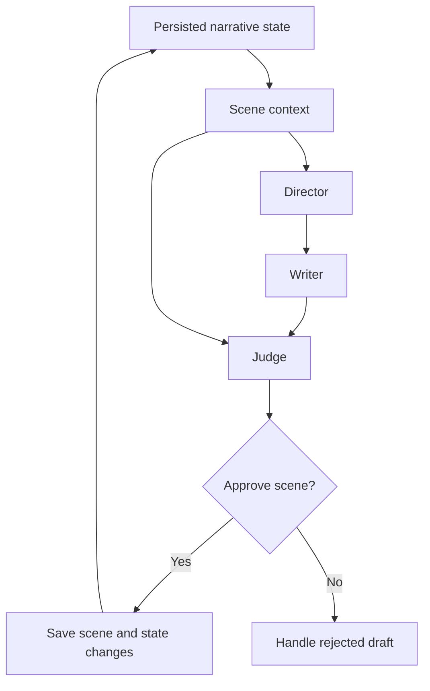

# DYSTOPIC 2067 Architecture

DYSTOPIC 2067 is a Python desktop application for producing stories, illustrations, and audiobooks. The Story Engine manages the narrative. The production workflows use scene text and identifiers as a shared reference while managing their own outputs, including images, voice takes, audio mixes, and EPUB files.

## Story Engine

The engine uses multiple LLMs across specialized roles.

| Role | Responsibility |
| --- | --- |
| Director | Guides scene development using narrative objectives and story context. |
| Writer | Drafts the scene. |
| Judge | Evaluates the draft against narrative and continuity requirements. |
| Micro Repair Writer | Proposes targeted revisions to a draft. |
| Micro Repair Judge | Evaluates those revisions. |

The diagram shows the main scene workflow at a conceptual level. The repair roles are listed separately because this view focuses on the approval and persistence boundary.

The engine tracks characters, relationships, memories, world state, and story threads across scenes. For example, evaluating whether a character can act on a piece of information requires context about how that character learned it. A fluent draft can still fail that check.

One scene can change several parts of the narrative state. The intended behavior is for approval to determine which changes become part of the active story. Rejected drafts, interrupted saves, and retries are cases under active stabilization.

## Desktop production workflows

The desktop GUI brings together story generation, proofreading, image generation, and audio production. A dedicated AI proofreading workflow supports editorial review. Images can be generated through a remote API or locally with Juggernaut.

Audiobook production uses scene text for two workflows.

| Workflow | Processing |
| --- | --- |
| Narration | An AI stage segments and tags the text. A text-to-speech API renders the segments using voice profiles for the narrator, main characters, and supporting characters. |
| Sound effects | An AI stage identifies sound cues in the text. A separate selection stage searches a local sound library for suitable assets and sends missing effects to a generation API. |

Publishing workflows support EPUB production and a web-based CMS.

## Revision and recovery

Scene identifiers link production artifacts to the story. A rollback can remove a scene from the active chronology while leaving its voice takes or sound effects on disk. Recovery therefore needs to account for both the committed narrative state and the artifacts that downstream tools can still see.

Current work focuses on story thread lifecycle, continuity checks, and consistency around scene approval, persistence, and recovery.

[Back to the showcase README](README.md)
